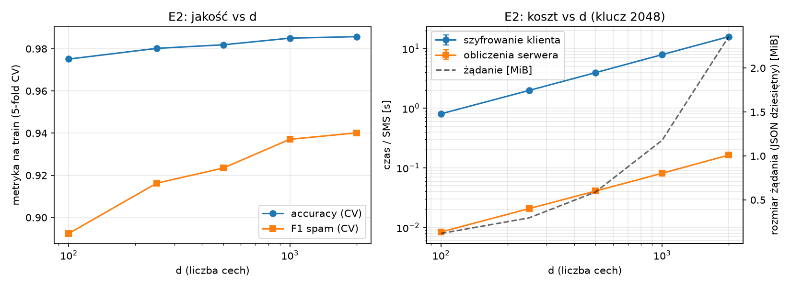
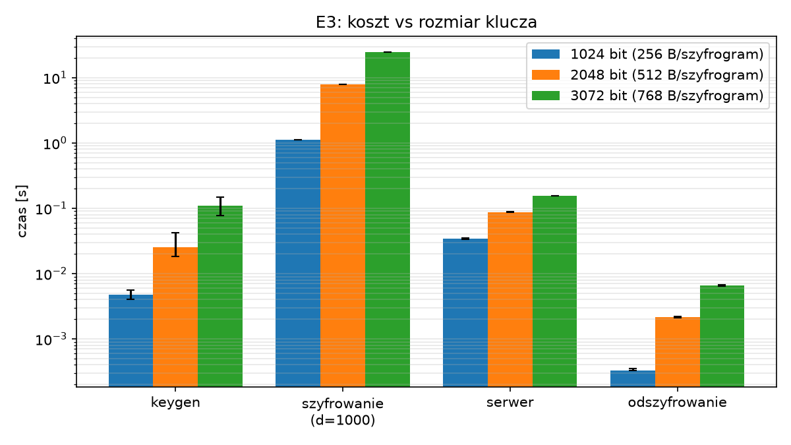
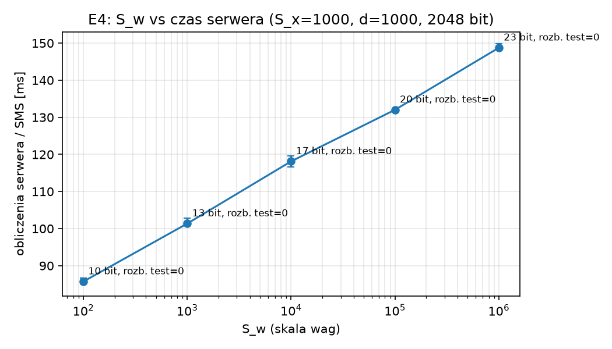
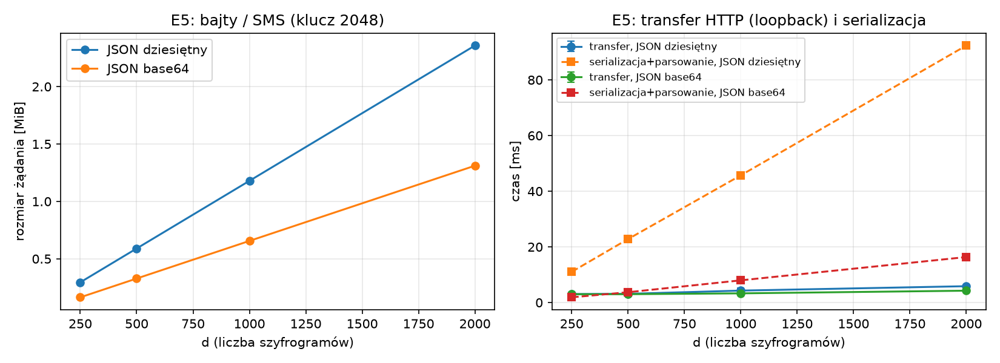
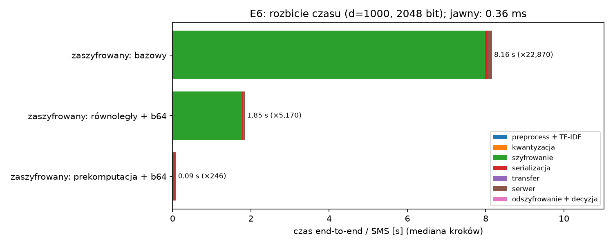
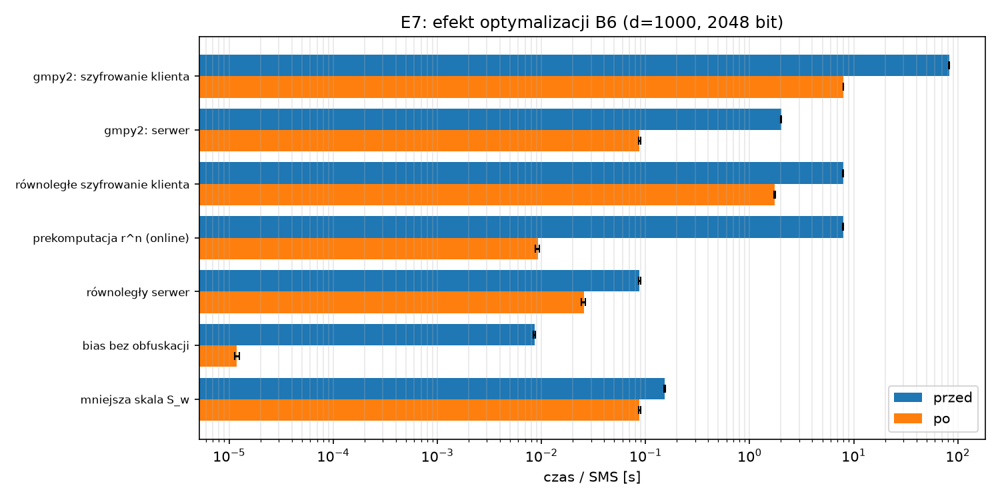

# W2 — pomiary wydajności (E2–E7) i optymalizacje B6

Wszystkie czasy: mediana [Q1–Q3] z powtórzeń po jednej rozgrzewce (wersja jawna w E6: 20× więcej powtórzeń, bo trwa poniżej 1 ms). Pamięć to szczyt `tracemalloc` w procesie głównym (bez procesów roboczych). Wygenerowane przez `make bench` (`scripts/bench.py`).

## Środowisko

- CPU: AMD Ryzen 5 4500U with Radeon Graphics (6 wątków logicznych), RAM: 7.45 GiB
- System: Linux-6.6.87.2-microsoft-standard-WSL2-x86_64-with-glibc2.43 (WSL2: True)
- Python 3.14.4, phe 1.5.0, gmpy2 2.3.2
- Powtórzenia: 10, procesy robocze: 6, d=1000, S_x=1000.0, S_w=100.0
- Data: 2026-11-03T19:24:44+00:00

[!] WSL2 dzieli CPU z Windows; pomiary robione bez innych obciążających procesów, ale rozrzut (IQR) jest większy niż na natywnym Linuksie.

## E2 — wpływ d na jakość i koszt (klucz 2048)

| d | CV acc | CV F1 | szyfrowanie / SMS | serwer / SMS | żądanie dec | żądanie b64 |
| ---: | ---: | ---: | ---: | ---: | ---: | ---: |
| 100 | 0.9751 | 0.8925 | 804.9 ms [792.7 ms–831.8 ms] | 8.4 ms [8.0 ms–8.9 ms] | 0.12 MiB | 0.07 MiB |
| 250 | 0.9802 | 0.9163 | 1.98 s [1.97 s–1.99 s] | 20.7 ms [20.4 ms–21.8 ms] | 0.30 MiB | 0.16 MiB |
| 500 | 0.9819 | 0.9235 | 3.94 s [3.93 s–3.95 s] | 40.8 ms [40.2 ms–41.1 ms] | 0.59 MiB | 0.33 MiB |
| 1000 | 0.9850 | 0.9371 | 7.90 s [7.88 s–7.95 s] | 81.2 ms [79.9 ms–82.2 ms] | 1.18 MiB | 0.66 MiB |
| 2000 | 0.9857 | 0.9401 | 15.81 s [15.77 s–15.83 s] | 163.5 ms [163.0 ms–169.0 ms] | 2.36 MiB | 1.31 MiB |

## E3 — wpływ rozmiaru klucza (d=1000)

| klucz | keygen | szyfrowanie / SMS | serwer | odszyfrowanie | szyfrogram | żądanie dec |
| ---: | ---: | ---: | ---: | ---: | ---: | ---: |
| 1024 | 4.7 ms [4.0 ms–5.5 ms] | 1.12 s [1.12 s–1.13 s] | 34.1 ms [33.5 ms–35.0 ms] | 328 µs [325 µs–353 µs] | 256 B | 0.59 MiB |
| 2048 | 25.6 ms [18.4 ms–42.3 ms] | 7.90 s [7.88 s–7.95 s] | 87.6 ms [86.6 ms–88.5 ms] | 2.1 ms [2.1 ms–2.2 ms] | 512 B | 1.18 MiB |
| 3072 | 108.6 ms [77.0 ms–147.5 ms] | 24.79 s [24.73 s–24.80 s] | 155.9 ms [154.8 ms–157.0 ms] | 6.6 ms [6.5 ms–6.8 ms] | 768 B | 1.77 MiB |

## E4 — skala kwantyzacji wag S_w (S_x=1e3, klucz 2048)

| S_w | max abs(w_q) | bity | rozbieżności train | rozbieżności test | serwer / SMS |
| ---: | ---: | ---: | ---: | ---: | ---: |
| 100 | 664 | 10 | 0 | 0 | 85.7 ms [85.1 ms–86.7 ms] |
| 1000 | 6644 | 13 | 0 | 0 | 101.4 ms [100.8 ms–102.8 ms] |
| 10000 | 66442 | 17 | 0 | 0 | 118.1 ms [116.7 ms–119.6 ms] |
| 100000 | 664418 | 20 | 0 | 0 | 132.0 ms [131.7 ms–132.4 ms] |
| 1e+06 | 6644178 | 23 | 0 | 0 | 148.8 ms [148.1 ms–149.8 ms] |

## E5 — narzut komunikacyjny (HTTP na loopbacku, klucz 2048)

| d | kodowanie | żądanie | B / szyfrogram | odpowiedź | serializacja | parsowanie | transfer |
| --- | --- | ---: | ---: | ---: | ---: | ---: | ---: |
| 250 | dec | 0.30 MiB | 1238 | 1259 B | 8.3 ms [8.0 ms–8.5 ms] | 2.8 ms [2.7 ms–2.8 ms] | 3.1 ms [2.9 ms–3.2 ms] |
| 250 | b64 | 0.16 MiB | 690 | 1259 B | 1.3 ms [1.2 ms–1.3 ms] | 616 µs [554 µs–736 µs] | 3.0 ms [2.7 ms–3.2 ms] |
| 500 | dec | 0.59 MiB | 1237 | 1259 B | 17.1 ms [16.3 ms–17.1 ms] | 5.7 ms [5.7 ms–6.2 ms] | 3.1 ms [2.8 ms–3.4 ms] |
| 500 | b64 | 0.33 MiB | 688 | 1259 B | 2.5 ms [2.4 ms–2.6 ms] | 1.2 ms [1.1 ms–1.4 ms] | 3.0 ms [2.9 ms–3.2 ms] |
| 1000 | dec | 1.18 MiB | 1236 | 1259 B | 34.1 ms [33.5 ms–34.5 ms] | 11.6 ms [11.3 ms–12.3 ms] | 4.3 ms [3.7 ms–5.3 ms] |
| 1000 | b64 | 0.66 MiB | 688 | 1259 B | 5.6 ms [5.4 ms–6.2 ms] | 2.4 ms [2.3 ms–2.5 ms] | 3.3 ms [3.1 ms–3.9 ms] |
| 2000 | dec | 2.36 MiB | 1236 | 1259 B | 68.2 ms [67.8 ms–68.6 ms] | 24.1 ms [23.3 ms–24.6 ms] | 5.9 ms [5.3 ms–6.3 ms] |
| 2000 | b64 | 1.31 MiB | 687 | 1259 B | 11.5 ms [11.0 ms–12.0 ms] | 4.8 ms [4.8 ms–4.9 ms] | 4.3 ms [3.8 ms–5.0 ms] |

Transfer = czas żądania HTTP minus czas obliczeń z nagłówka `Server-Timing`; na loopbacku to głównie koszt stosu HTTP i kopiowania bajtów, w prawdziwej sieci rośnie liniowo z rozmiarem żądania.

## E6 — narzut całkowity względem wersji jawnej (d=1000, klucz 2048)

| wariant | end-to-end / SMS | SMS/s | narzut | pamięć klient (peak) | pamięć serwer (peak) |
| --- | ---: | ---: | ---: | ---: | ---: |
| jawny | 357 µs [322 µs–435 µs] | 2,801.41 | 1× | 4.4 KiB | – |
| zaszyfrowany: bazowy | 8.16 s [8.13 s–8.18 s] | 0.12 | 22,870× | 3.08 MiB | 705.7 KiB |
| zaszyfrowany: równoległy + b64 | 1.85 s [1.83 s–1.85 s] | 0.54 | 5,170× | 2.56 MiB | 889.4 KiB |
| zaszyfrowany: prekomputacja + b64 | 87.7 ms [87.1 ms–91.1 ms] | 11.40 | 246× | 2.56 MiB | 889.4 KiB |

Rozbicie (mediany):

| wariant | featurize | quantize | encrypt | serialize | transfer | server | decrypt |
| --- | ---: | ---: | ---: | ---: | ---: | ---: | ---: |
| zaszyfrowany: bazowy | 677 µs | 287 µs | 7.98 s | 63.9 ms | 5.2 ms | 108.6 ms | 2.5 ms |
| zaszyfrowany: równoległy + b64 | 738 µs | 300 µs | 1.77 s | 36.3 ms | 3.7 ms | 34.8 ms | 2.7 ms |
| zaszyfrowany: prekomputacja + b64 | 730 µs | 330 µs | 8.3 ms | 37.1 ms | 3.7 ms | 35.3 ms | 2.6 ms |

Wariant z prekomputacją dodatkowo liczy offline pulę `r^n` (1.82 s [1.80 s–1.83 s] na SMS), zanim wiadomość istnieje.

## E7 / B6 — efekt optymalizacji (przed / po, d=1000, klucz 2048)

| optymalizacja | wariant | mediana [Q1–Q3] | uwagi |
| --- | --- | ---: | ---: |
| gmpy2: szyfrowanie klienta | przed (czysty Python) | 82.44 s [82.04 s–82.76 s] | zmierzone na 100 współrzędnych, przeskalowane ×10 |
| gmpy2: szyfrowanie klienta | po (gmpy2) | 7.93 s [7.91 s–7.98 s] | zmierzone na 100 współrzędnych, przeskalowane ×10 |
| gmpy2: serwer | przed (czysty Python) | 2.00 s [2.00 s–2.01 s] |  |
| gmpy2: serwer | po (gmpy2) | 86.8 ms [86.4 ms–89.5 ms] |  |
| równoległe szyfrowanie klienta | przed (1 proces) | 7.90 s [7.88 s–7.95 s] |  |
| równoległe szyfrowanie klienta | po (6 procesów) | 1.74 s [1.72 s–1.76 s] |  |
| prekomputacja r^n (online) | przed (r^n w trakcie) | 7.90 s [7.88 s–7.95 s] |  |
| prekomputacja r^n (online) | po (pula offline) | 9.3 ms [8.8 ms–9.5 ms] | r^n liczone wcześniej (koszt offline w wierszu niżej) |
| prekomputacja r^n (offline, informacyjnie) | napełnienie puli, 6 procesów | 1.84 s [1.82 s–1.86 s] |  |
| równoległy serwer | przed (1 proces) | 86.8 ms [86.4 ms–89.5 ms] |  |
| równoległy serwer | po (6 procesów) | 25.7 ms [24.3 ms–26.6 ms] |  |
| bias bez obfuskacji | przed (Enc(b) z r^n) | 8.6 ms [8.3 ms–8.8 ms] |  |
| bias bez obfuskacji | po (Enc(b) z r=1) | 12 µs [11 µs–13 µs] | oszczędza jedno r^n na żądanie (wynik i tak jest obfuskowany) |
| mniejsza skala S_w | przed (S_w=1e6) | 152.9 ms [151.4 ms–155.3 ms] |  |
| mniejsza skala S_w | po (S_w=100) | 86.8 ms [86.4 ms–89.5 ms] |  |
| kompaktowa serializacja | przed (JSON dziesiętny) | 1.179 MiB |  |
| kompaktowa serializacja | po (JSON base64) | 0.656 MiB |  |

Przyspieszenie (mediana przed / po):

- gmpy2: szyfrowanie klienta: 10.4×
- gmpy2: serwer: 23.1×
- równoległe szyfrowanie klienta: 4.5×
- prekomputacja r^n (online): 847.6×
- równoległy serwer: 3.4×
- bias bez obfuskacji: 722.8×
- mniejsza skala S_w: 1.8×
- kompaktowa serializacja: 1.8×

